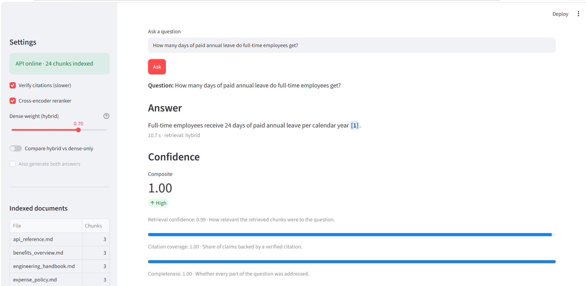
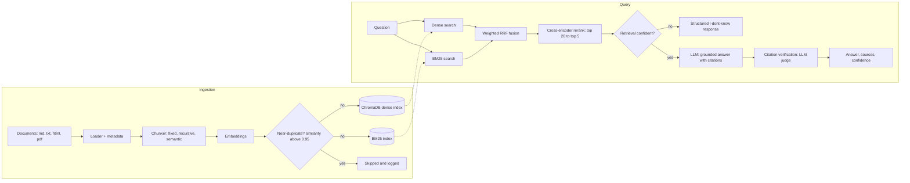
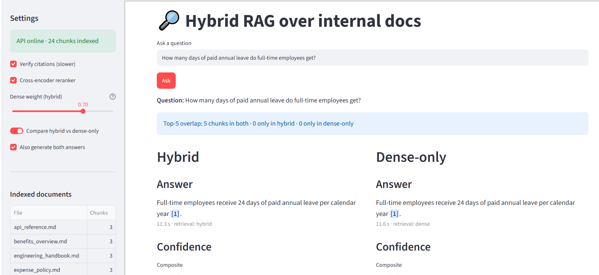
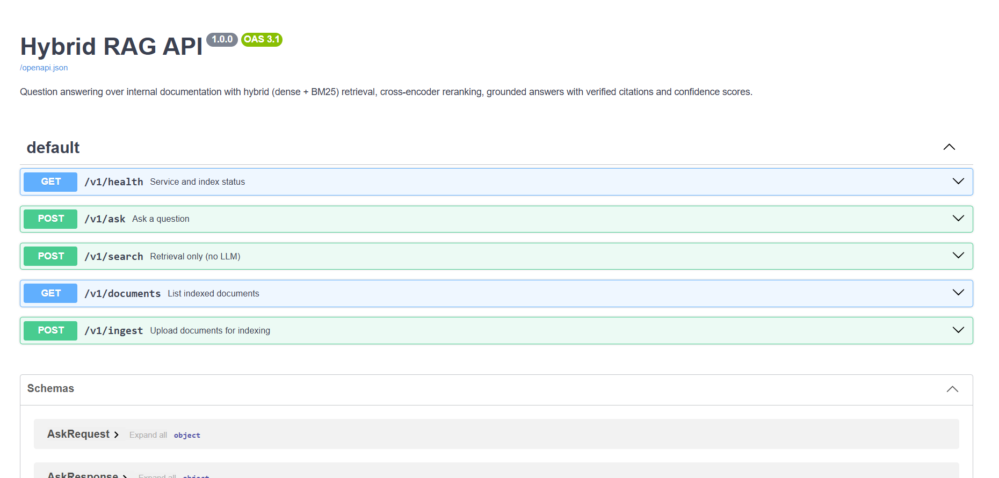

# Hybrid RAG over Internal Docs

[](https://github.com/Shimaaelkanj/hybrid-rag-internal-docs/actions)

A production-style Retrieval-Augmented Generation (RAG) system that answers questions about internal documentation using **hybrid retrieval, cross-encoder reranking, cited answers, citation verification and confidence scoring**. It includes an evaluation framework, a REST API, a Streamlit dashboard and a one-command Docker setup.



## Why this project

Most RAG demos index one PDF and stop. This project focuses on what makes RAG trustworthy in practice:

- **Retrieval quality:** dense and keyword search are combined, then reranked, so both paraphrased questions and exact terms (error codes, config keys) work.
- **Grounding:** answers cite their sources, every citation is checked by an LLM judge, and the system refuses to answer when the evidence is weak.
- **Measurement:** a hand-checked golden dataset and automated metrics show what each design decision changes.

## Features

- Multi-format ingestion (Markdown, text, HTML, PDF) with metadata: source, section heading, page. Raw and processed copies are kept so you can re-index without re-uploading.
- Three switchable chunking strategies: fixed-size with overlap, recursive/structure-aware, and semantic (splits on topic boundaries using embedding similarity).
- Near-duplicate detection (cosine similarity > 0.95) before indexing.
- Hybrid retrieval: dense search (ChromaDB) + sparse search (BM25), merged with weighted Reciprocal Rank Fusion.
- Cross-encoder reranking: the top 20 fused candidates are rescored and the best 5 kept.
- Grounded answers with `[n]` citations, per-claim citation verification and a composite confidence score (retrieval, citation coverage, completeness).
- Graceful "I don't know": when retrieval confidence is low the system returns what it found, what it could not find, and which documents to check manually.
- Evaluation framework: 56-case golden dataset, automated metrics, chunking-strategy comparison report and a regression gate for CI.
- FastAPI service with OpenAPI docs, Streamlit dashboard, Docker Compose (API + ChromaDB + dashboard) with a seeded sample corpus.

## Architecture



## Tech stack

| Component | Choice |
|---|---|
| Language | Python 3.10+ (Docker image uses 3.11) |
| Embeddings | `all-MiniLM-L6-v2` (local, free). OpenAI `text-embedding-3-small` is supported via `EMBEDDING_PROVIDER=openai` (re-index after switching) |
| Vector store | ChromaDB (server container in Docker, local files otherwise) |
| Sparse search | BM25 (`rank_bm25`) |
| Reranker | `cross-encoder/ms-marco-MiniLM-L-6-v2` |
| LLM | Any OpenAI-compatible endpoint: Ollama (local), Groq, OpenAI, ... |
| Chunking | LangChain text splitters + custom semantic chunker |
| API / UI | FastAPI, Streamlit |
| Packaging | Docker Compose |

## Quick start (Docker)

Requirements: Docker Desktop and an LLM, either [Ollama](https://ollama.com) running locally (`ollama pull llama3.2`) or an API key for a hosted OpenAI-compatible provider.

```bash
git clone https://github.com/Shimaaelkanj/hybrid-rag-internal-docs.git
cd hybrid-rag-internal-docs
cp .env.example .env        # Windows PowerShell: copy .env.example .env
docker compose up --build
```

The first build downloads PyTorch and the models and can take a while; later starts take seconds. The sample corpus is indexed automatically on first start.

| Service | URL |
|---|---|
| Dashboard | http://localhost:8501 |
| API docs (OpenAPI) | http://localhost:8000/docs |
| ChromaDB | http://localhost:8001 |


To use a hosted LLM instead of Ollama, set these in `.env` (any OpenAI-compatible provider works):

```
# Groq (free tier)
LLM_BASE_URL=https://api.groq.com/openai/v1
LLM_API_KEY=gsk_your_groq_key
LLM_MODEL=openai/gpt-oss-120b

# OpenAI
# LLM_BASE_URL=https://api.openai.com/v1
# LLM_API_KEY=sk-your_openai_key
# LLM_MODEL=gpt-4o-mini
```

With Ollama, leave these three variables out: the default is `llama3.2` running on your own machine. Model names change over time, so check your provider's current model list.

Stop with `docker compose down` (add `-v` to delete the stored indexes).

### Try it

| Question | What it demonstrates |
|---|---|
| How many days of paid annual leave do full-time employees get? | simple lookup with a clickable citation |
| What does NW-5003 mean? | exact-keyword match (BM25 strength) |
| I'm in my second month. Can I work remotely three days a week? | multi-document reasoning |
| What is the name of the CEO? | not in the corpus: the system declines instead of guessing |

Turn on **Compare hybrid vs dense-only** in the dashboard to see where the retrieval modes differ.



## API

| Endpoint | Description |
|---|---|
| `POST /v1/ask` | Answer with citations, sources, per-claim checks and confidence scores |
| `POST /v1/search` | Retrieval only: ranked chunks with dense rank, BM25 rank, fusion and rerank scores |
| `GET /v1/documents` | Indexed documents with chunk counts and sections |
| `POST /v1/ingest` | Upload documents (md, txt, html, pdf) for indexing |
| `GET /v1/health` | Service and index status |

```bash
curl -X POST http://localhost:8000/v1/ask \
  -H "Content-Type: application/json" \
  -d '{"question": "How many days of paid annual leave do full-time employees get?", "verify": false}'
```

Full request and response schemas are in the interactive docs at `/docs`.



## Local development (without Docker)

```bash
python -m venv .venv
source .venv/bin/activate          # Windows: .venv\Scripts\activate
pip install -r requirements.txt -r dashboard/requirements.txt
python -m app.seed --force         # indexes sample_docs (wipes the local index)
uvicorn app.api:app --reload --reload-dir app
streamlit run dashboard/app.py
```

Command-line tools: `python -m app.ingest <path> --strategy recursive`, `python -m app.search "query"`, `python -m app.ask "question"`.

## Evaluation

The evaluation suite measures every pipeline change against a golden dataset of 56 questions over an 8-document corpus (`eval/`):

| Question type | Count | Tests |
|---|---|---|
| lookup | 28 | a single fact from one section |
| multi-hop | 10 | combining information from two or more sections or documents |
| no answer | 10 | the system must decline, including near-miss questions |
| ambiguous | 8 | the answer must cover each interpretation |

| Metric | How it is measured |
|---|---|
| Retrieval recall / MRR / context precision | Do the retrieved chunks contain the evidence phrases? (no LLM) |
| Answer correctness | LLM judge compares the answer with the golden answer |
| Faithfulness | LLM judge checks every claim against all retrieved context |
| Citation accuracy | LLM judge checks each claim against the chunk it cites |
| False refusal / hallucination rate | Answerable questions refused / unanswerable questions answered |

```bash
python -m app.evaluate --strategy recursive --retrieval-only   # fast, no LLM
python -m app.compare                                          # all chunking strategies + report
python -m app.evaluate --strategy recursive --baseline eval/baseline.json   # regression gate (exit code 1 on regression)
```

### Results

Chunking strategies compared on the 56-question golden set (500-character chunks, 100 overlap; same questions, models and judge for every run):

| Strategy | Recall | MRR | Ctx precision | Correctness | Faithfulness | Citation acc. | False refusal | Hallucinated | Score |
|---|---|---|---|---|---|---|---|---|---|
| fixed | 1.00 | 0.99 | 0.27 | 0.79 | 0.98 | 0.95 | 0.11 | 0.00 | 0.93 |
| recursive | 1.00 | 0.99 | 0.27 | 0.79 | 0.98 | 0.95 | 0.11 | 0.00 | 0.93 |
| semantic | 1.00 | 0.99 | 0.27 | 0.81 | 0.98 | 0.95 | 0.11 | 0.00 | 0.93 |

**Findings**

- **Chunking strategy made no measurable difference on this corpus.** Retrieval is saturated (recall 1.00, MRR 0.99 for all three), so the strategies cannot be separated. The 0.02 correctness gap for semantic chunking is about one question out of 56, which is within judge noise, not a win. I kept `recursive` as the default: it matches the others on quality, preserves section boundaries, and avoids the extra cost of embedding every sentence at indexing time that semantic chunking requires.
- **The system never hallucinated.** All 10 unanswerable questions, including near-miss ones such as "dental insurance", were declined (hallucination rate 0.00), and 98% of claims were grounded in the retrieved context.
- **The main weakness is over-refusal.** About 11% of answerable questions (roughly 5 of 46) were refused by the confidence gate, and the remaining correctness gap comes from answers the judge marked partial. The next improvement is tuning the refusal threshold and examining the multi-hop and ambiguous cases, not changing the chunker.

**Caveats:** the corpus is small and synthetic, so strategy differences are expected to be small here. A larger corpus of long documents is needed to separate them. Correctness, faithfulness and citation scores come from an LLM judge and carry its noise. Latency is not compared because cached LLM calls made the timings unreliable.

Full report: [eval/report.md](eval/report.md)

## Design decisions

- **Reciprocal Rank Fusion** merges the dense and BM25 lists by rank, so their incompatible score scales never need normalising. The dense/sparse weight is configurable.
- **Retrieve wide, rerank narrow:** the cross-encoder is accurate but slow, so it only scores the fused shortlist.
- **Refusal threshold:** below a retrieval-confidence threshold the LLM is never called, which avoids fabricated answers and saves cost.
- **Separate judge model:** the judge can be a different (stronger) model than the generator, configured with `JUDGE_*` variables, to reduce self-grading bias.
- **Evidence-based retrieval metric:** relevance is matched on evidence phrases rather than chunk IDs, so results stay comparable across chunking strategies.
- **Local-first:** embeddings and reranking run locally and any OpenAI-compatible LLM works, so the project runs without paid APIs.

## Limitations

- The bundled corpus is small and synthetic. Retrieval differences between strategies are modest at this scale; use your own documents for realistic numbers.
- LLM-as-judge scores are noisy and depend on the judge model.
- The BM25 index is held in memory and rebuilt after each ingestion, which does not scale to very large corpora.
- No authentication, per-document permissions or streaming responses.

## Project structure

```
app/
  api.py          FastAPI service (/v1)
  ask.py          CLI: ask a question
  chunking.py     fixed / recursive / semantic strategies
  compare.py      chunking-strategy comparison report
  config.py       environment-driven settings
  embeddings.py   local or OpenAI embeddings
  eval_suite.py   evaluation metrics
  evaluate.py     evaluation CLI
  generation.py   grounded prompt, citation verification, confidence, I-don't-know
  indexing.py     ChromaDB + BM25 + dedup + sync check
  ingest.py       ingestion pipeline CLI
  llm.py          OpenAI-compatible client, judge model, cache
  loaders.py      md / txt / html / pdf loaders
  retrieval.py    dense, sparse, RRF fusion, reranker
  search.py       CLI: retrieval only
  seed.py         indexes sample_docs on first start
dashboard/        Streamlit UI
eval/             golden.json, corpus/, results/, report.md
sample_docs/      corpus indexed automatically in Docker
tests/            unit and API tests
```

## Tests

```bash
python -m pytest -q
```

## License

MIT